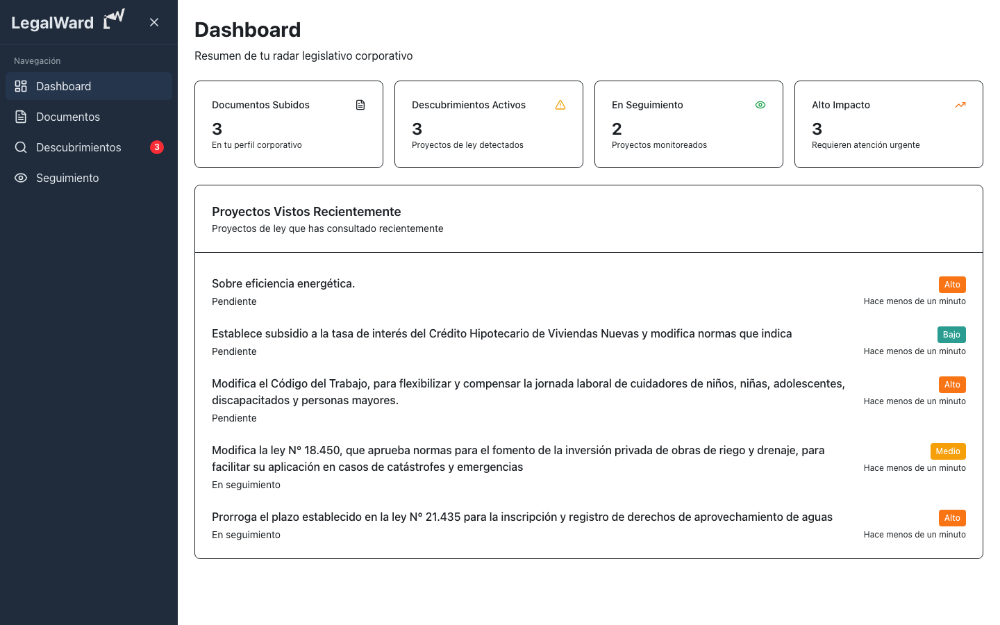
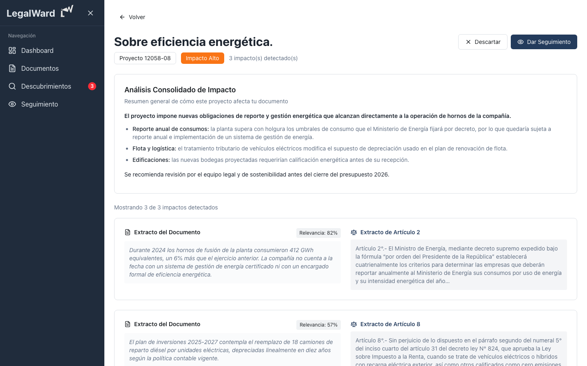
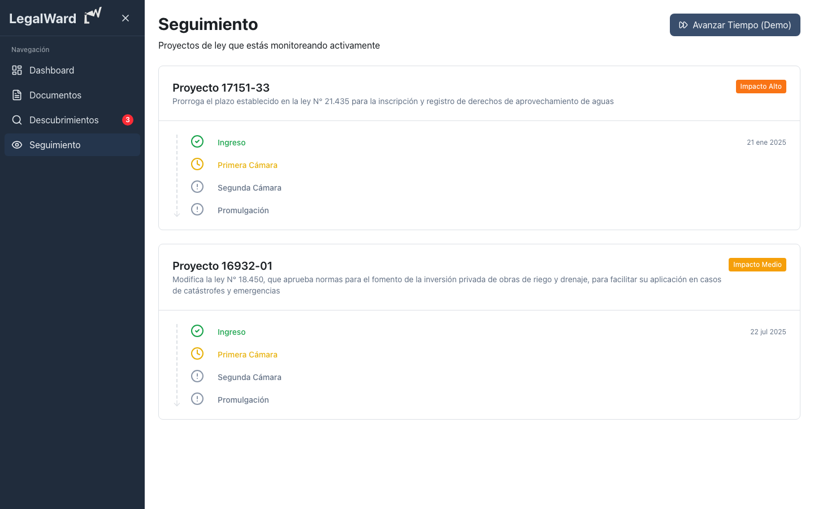
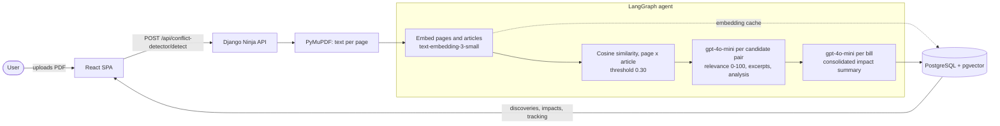

# Legal Ward

**An AI radar for pending legislation.** Upload a company document (an annual
report, an internal policy) and Legal Ward checks it against bills in the
Chilean Congress, flags the articles that could affect you, scores each
finding and explains why.

Built over one weekend by a team of four at **Platanus Hack 25**
(21–23 November 2025).



> The screenshots show clearly fictional demo data (an invented company,
> "Envases del Maule"). The bills and article excerpts are the six real bills
> shipped with the repo as seed data.

## The problem

Hundreds of bills move through the Chilean Congress at any time. Finding out
which ones touch your operations means lawyers reading them one by one, so
most organisations learn about a regulatory change when it is already too late
to prepare. Legal Ward turns that around: you describe yourself once, through
your own documents, and the system tells you which bills to watch.

## What it does

- **Analyse a PDF** against every article of the loaded bills.
- **Discoveries**: one card per bill that may affect you, with an impact level
  (high / medium / low) derived from a 0–100 relevance score.
- **Side-by-side evidence**: the excerpt of your document next to the excerpt
  of the article it collides with, plus a consolidated analysis written by the
  LLM.
- **Tracking**: follow a bill and see its legislative stage (entry, first
  chamber, second chamber, enactment), or discard it.

| Discovery detail | Bill tracking |
| --- | --- |
|  |  |

## How it works



1. **Extract.** The backend reads the PDF with PyMuPDF, one text block per page.
2. **Retrieve.** Pages and bill articles are embedded with OpenAI
   `text-embedding-3-small`. Embeddings are cached in PostgreSQL (a pgvector
   column keyed by a SHA-256 of the text), so bills are only embedded once.
   Every page/article pair above a cosine similarity of 0.30 becomes a
   candidate.
3. **Judge.** Each candidate goes to `gpt-4o-mini` with a structured-output
   prompt that returns the two relevant excerpts, a relevance score from 0 to
   100 and a short legal analysis. Pairs scored 0 are dropped.
4. **Consolidate.** Findings are grouped by bill and summarised into one
   analysis per bill, which is stored and shown in the UI.

Main code locations:

| Path | What lives there |
| --- | --- |
| `backend/apps/conflict_detector/agent/` | LangGraph graph, retrieval, prompts, parallel LLM map |
| `backend/apps/conflict_detector/api.py` | REST endpoints (documents, discoveries, tracking) |
| `backend/apps/proyectos_ley/` | Bill and article models, seed-data migration |
| `backend/data/proyectos_ley/*.json` | The six seeded bills |
| `frontend/src/routes/` | Dashboard, documents, discoveries, tracking |
| `frontend/src/services/auth/` | Session auth against django-allauth headless |

## Stack

- **Backend:** Python 3.13, Django 5.2, Django Ninja, django-allauth
  (headless), LangGraph, LangChain OpenAI, OpenAI API, PyMuPDF, NumPy
- **Data:** PostgreSQL 16 with pgvector
- **Frontend:** React 19, TypeScript, Vite, TanStack Router, TanStack Query,
  Tailwind CSS 4
- **Tooling:** Docker Compose, uv, pnpm, just; the hackathon deployment ran on
  Railway

## Running it locally

Environment variables are documented in [`.env.example`](.env.example).
Analysing a new document needs an OpenAI API key; browsing existing results
does not.

### Option A: without Docker (verified, November 2026)

Requires [uv](https://github.com/astral-sh/uv), Node 22 and pnpm. This uses
SQLite, which is enough to log in and browse the UI.

```bash
# Terminal 1: backend
cd backend
uv sync
export DJANGO_SECRET_KEY=dev-only-change-me
export DJANGO_DEBUG=true
export DJANGO_DATABASE_URL=sqlite:///db.sqlite3
export DJANGO_FRONTEND_URL=http://localhost:3000
uv run python manage.py migrate          # also loads the six seed bills
uv run python manage.py createsuperuser  # email + password
uv run python manage.py runserver 127.0.0.1:8000

# Terminal 2: frontend
cd frontend
pnpm install
VITE_PROXY_BACKEND_URL=http://127.0.0.1:8000 pnpm dev --port 3000
```

Open <http://localhost:3000> and log in with the user you created.

To run the analysis itself, point `DJANGO_DATABASE_URL` at a PostgreSQL
database that has the pgvector extension available and export
`PROJECT_OPENAI_API_KEY`. That path was not re-run while writing this README.

### Option B: Docker Compose

This is how the team ran it during the hackathon. It was not re-verified for
this README (the compose file validates, but the stack was not started).

```bash
# Optional: your OpenAI key, in a git-ignored file
echo "PROJECT_OPENAI_API_KEY=sk-..." > local/conf/local.env

cd local
docker compose up -d --build
docker compose exec backend python manage.py migrate
docker compose exec backend python manage.py createsuperuser
```

Frontend on <http://localhost:3000>, API on <http://localhost:8000>
(interactive docs at `/api/docs`). The `just` recipes in `local/.justfile`
wrap the same commands.

## Known limitations

This is a hackathon prototype, not a product.

- **Six bills, loaded by hand.** There is no integration with the Congress
  systems; bills come from JSON files loaded by a migration.
- **The tracking timeline is simulated.** Stages advance with a demo button
  ("Avanzar Tiempo") and dates are derived from the bill's filing date.
- **Analysis runs inside the HTTP request.** There is no job queue, so a long
  PDF can exceed the request timeout, and cost grows with pages x articles.
- **pgvector is only a cache.** Similarity is computed in-process with NumPy,
  not with a vector index, and the LangGraph graph has a single node.
- **No automated tests**, and LLM output is not evaluated against a labelled
  set. Findings are leads for a lawyer to review, not legal advice.
- **Uploaded PDFs are not stored**, only their name and the findings.
- **Security hardening is incomplete.** CSRF protection is disabled, session
  cookies are configured for a cross-site deployment (`SameSite=None; Secure`,
  so local login needs a browser that treats `http://localhost` as secure,
  such as Chrome or Firefox), and dependencies are pinned to November 2025
  versions. Do not deploy it as is.
- **The UI is in Spanish only.**

## Hackathon and team

Legal Ward was team 39's project at Platanus Hack 25, in the "legacy" track.
The official submission lives at
[platanus-hack/platanus-hack-25-team-39](https://github.com/platanus-hack/platanus-hack-25-team-39);
this repository is the team's working repository with the full commit history.

Team, as recorded in the commit history:

- Felipe Mellado
- Brayan Moreno
- Tomás Morales
- Tomás Werth

The sample document offered in the upload menu
(`frontend/src/assets/memoria_cristaleria.pdf`) is a publicly available annual
report of a third party, included only as test input.
